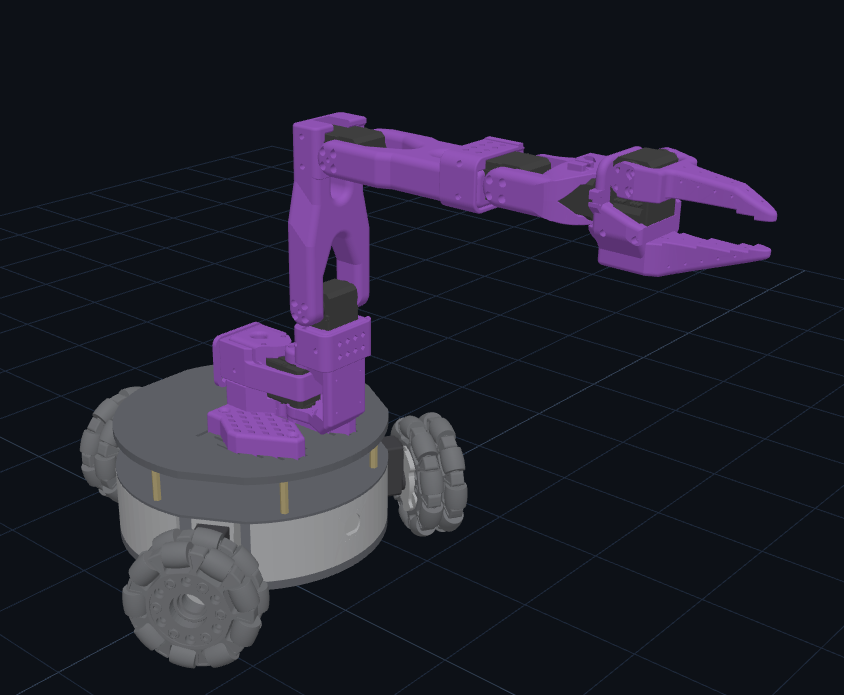

# LeKiwi ROS 2 워크스페이스



LeKiwi(옴니휠 3륜 베이스 + SO-101 팔)를 ROS 2 Jazzy로 움직이는 워크스페이스.
센서 · 모터 · 지도 · 자율 주행 · 조작은 **로봇(Raspberry Pi)에서 돌고, PC는 RViz로 보기만 한다.**

이 문서는 **받기 → 준비 → 빌드**까지다. 빌드가 끝나면 [src/README.md](src/README.md)로 간다 (로봇 켜기 · RViz · 키보드 주행 · 지도 · 자율 주행).

**목차**

1. [어디에 무엇을 설치하나](#1-어디에-무엇을-설치하나)
2. [저장소 받기](#2-저장소-받기-git-clone)
3. [미리 되어 있어야 하는 것](#3-미리-되어-있어야-하는-것)
4. [라이브러리 설치](#4-라이브러리-설치)
5. [빌드 (CPU 사용 수 제어)](#5-빌드-cpu-사용-수-제어)
6. [빌드 결과 쓰기 · 확인](#6-빌드-결과-쓰기--확인)
7. [다음 단계](#7-다음-단계)

---

## 1. 어디에 무엇을 설치하나

| | 로봇 (Raspberry Pi 4) | PC |
|---|---|---|
| 하는 일 | 센서 · 모터 · 지도 · Nav2 · 조작 실행 | RViz로 보기만 |
| OS · ROS | Ubuntu 24.04 · ROS 2 Jazzy (`ros-base`) | Ubuntu 24.04 · ROS 2 Jazzy (`desktop`) |
| 받을 위치 | `~/lekiwi_ws` (**이 경로 그대로**) | `~/lekiwi_ws` (다른 폴더도 된다) |
| 빌드하는 패키지 | 전부 (13개) | `lekiwi_description` 하나 |
| 라이다 SDK | 필요 | 필요 없음 |

로봇은 장비별 설정을 `~/lekiwi_ws/robot_profile.yaml` · `~/lekiwi_ws/arm_profile.yaml`에서 찾는다. 그래서 로봇에서는 폴더 이름을 바꾸지 않는다.

---

## 2. 저장소 받기 (git clone)

**저장소 자체가 colcon 워크스페이스**다. 안에 이미 `src/`가 있으므로 `~/lekiwi_ws`에 받는다. `~/lekiwi_ws/src`에 받지 않는다 (`src/src/...`가 된다).

```bash
cd ~
git clone -b feature/lekiwi-ros2 https://github.com/roboseasy/lekiwi.git ~/lekiwi_ws
cd ~/lekiwi_ws
ls            # src 가 보이면 된다
```

```text
~/lekiwi_ws                  ← 저장소 루트 = colcon 워크스페이스. colcon 명령은 항상 여기서
├── src/                     ← ROS 2 패키지, 문서
│   ├── README.md            ← 사용 설명서 (빌드 후 여기로)
│   ├── docs/                ← 인터페이스 · 현장 확인 · 카메라
│   ├── lekiwi_msgs/  lekiwi_description/  lekiwi_bringup/
│   ├── lekiwi_motor/        ← lekiwi_motor_driver, lekiwi_base_controller
│   ├── lekiwi_sensor/       ← lekiwi_imu, lekiwi_lidar, lekiwi_scan_filter, lekiwi_camera
│   ├── lekiwi_teleop/  lekiwi_cartographer/  lekiwi_navigation2/  lekiwi_lerobot/
├── build/  install/  log/   ← 빌드하면 생긴다 (git에는 올라가지 않는다)
```

로봇에 `~/lekiwi_ws`가 이미 있으면 (예전 구조) 지우지 말고 옮겨 둔 뒤 받는다.

```bash
mv ~/lekiwi_ws ~/lekiwi_ws.bak
```

---

## 3. 미리 되어 있어야 하는 것

| 항목 | 확인 | 없으면 |
|---|---|---|
| Ubuntu 24.04 | `lsb_release -rs` → `24.04` | 24.04를 설치한다 (Pi는 aarch64 Ubuntu Server 24.04) |
| ROS 2 Jazzy | `ls /opt/ros` → `jazzy` | [공식 설치 문서](https://docs.ros.org/en/jazzy/Installation/Ubuntu-Install-Debs.html). 로봇은 `ros-jazzy-ros-base`, PC는 `ros-jazzy-desktop` |
| 인터넷 | `git ls-remote https://github.com/roboseasy/lekiwi.git` | 받기와 apt 설치에 필요하다 |
| 로봇: 시리얼 권한 | `id` 결과에 `dialout` | `sudo usermod -aG dialout $USER` 후 다시 로그인 (모터 · 라이다 USB 시리얼) |

---

## 4. 라이브러리 설치

비밀번호(sudo)가 필요하다. 빌드 도구는 공통이다.

```bash
sudo apt update
sudo apt install ros-dev-tools          # colcon · rosdep · vcstool
```

### 4-1. PC

```bash
sudo apt install ros-jazzy-xacro ros-jazzy-joint-state-publisher \
  ros-jazzy-nav2-rviz-plugins           # 마지막은 RViz의 Nav2 Goal 도구
```

### 4-2. 로봇 (Raspberry Pi)

화면이 없는 Pi에 쓸모없는 Qt 패키지(`rviz2` 등)가 깔리지 않도록 `rosdep install` 대신 **필요한 것만 apt로** 설치한다.

```bash
# 빌드 도구 · 라이브러리
sudo apt install build-essential cmake git python3-tk libopencv-dev libeigen3-dev \
  ros-jazzy-xacro ros-jazzy-joint-state-publisher ros-jazzy-robot-state-publisher

# 지도 작성 · 자율 주행 (Nav2 포함, 약 400개 · 2~3 GB)
sudo apt install --no-install-recommends ros-jazzy-cartographer-ros \
  ros-jazzy-nav2-map-server ros-jazzy-nav2-amcl ros-jazzy-nav2-behaviors ros-jazzy-nav2-bt-navigator \
  ros-jazzy-nav2-collision-monitor ros-jazzy-nav2-common ros-jazzy-nav2-controller ros-jazzy-nav2-costmap-2d \
  ros-jazzy-nav2-lifecycle-manager ros-jazzy-nav2-mppi-controller ros-jazzy-nav2-navfn-planner \
  ros-jazzy-nav2-planner ros-jazzy-nav2-smoother ros-jazzy-nav2-velocity-smoother ros-jazzy-nav2-waypoint-follower
```

### 4-3. 로봇: YDLIDAR SDK (apt에 없다)

`lekiwi_lidar`가 `/usr/local`에 설치된 SDK를 링크한다. 이 저장소에는 SDK가 들어 있지 않다. **PC에는 필요 없다.**

```bash
ls /usr/local/lib/cmake/ydlidar_sdk     # 파일이 보이면 이미 설치됨 → 4-4로

cd ~
git clone https://github.com/YDLIDAR/YDLidar-SDK.git ~/YDLidar-SDK
cd ~/YDLidar-SDK
git checkout 42a82ed10d2304094c111fc63dee8e4a229b79b7     # 확인한 버전
mkdir -p build && cd build
cmake ..
make -j2                                                  # 코어 수 제한 (5장 참고)
sudo make install
```

### 4-4. (선택)

| 필요한 때 | 설치 |
|---|---|
| 로봇 팔로워 팔(`use_arm`) | lerobot 0.6.0 가상환경 `~/lerobot060_venv`. 없으면 팔로워만 건너뛰고 나머지는 돈다. [src/lekiwi_lerobot/README.md](src/lekiwi_lerobot/README.md) |
| 키보드 조작 창의 한글 (로봇) | `sudo apt install fonts-nanum` |
| 카메라 영상 보기 | `sudo apt install ros-jazzy-compressed-image-transport` ([src/docs/camera.md](src/docs/camera.md)) |

---

## 5. 빌드 (CPU 사용 수 제어)

`colcon build`는 기본으로 **CPU 코어 수만큼 패키지를 동시에** 빌드하고, 패키지 안의 컴파일도 병렬로 돈다. Pi 4(4코어)에서는 CPU · 메모리를 다 써서 멈추거나 `Killed`로 끊길 수 있다.
아래 `JOBS` 하나로 **동시에 빌드하는 패키지 수**와 **패키지 안의 컴파일 수**를 함께 정한다.

```bash
cd ~/lekiwi_ws
source /opt/ros/jazzy/setup.bash
deactivate 2>/dev/null                  # (venv) 표시가 있으면 끈다. 켜진 채로는 빌드가 실패한다 ↓

export JOBS=2
export MAKEFLAGS="-j$JOBS" CMAKE_BUILD_PARALLEL_LEVEL=$JOBS
```

| 상황 | `JOBS` | 추가 옵션 |
|---|---|---|
| Pi 4 기본 | `2` | |
| Pi에서 로봇 노드가 돌고 있거나 메모리가 모자랄 때 | `1` | `--executor sequential` (패키지를 하나씩) |
| PC | `4` (코어가 많아도 이 정도면 충분하다) | |

**PC** — 모델 패키지 하나만:

```bash
colcon build --symlink-install --parallel-workers $JOBS --packages-select lekiwi_description
```

**로봇 (Pi)** — 4-3의 SDK를 먼저 설치한 뒤 전부:

```bash
colcon build --symlink-install --parallel-workers $JOBS
```

끝에 `Summary: 13 packages finished`(PC는 `1 package finished`)가 나오면 된다.

- `--symlink-install`: `config/` · `launch/` · RViz 설정을 고치면 **다시 빌드하지 않아도** 노드를 재시작하면 적용된다. `.cpp` · `.hpp`를 고쳤을 때만 다시 빌드한다.
- 일부만 다시 빌드: `colcon build --symlink-install --parallel-workers $JOBS --packages-select <패키지>`
- 처음부터 다시: `rm -rf build install log` 후 위 빌드를 다시 한다.

### 빌드가 실패할 때

| 증상 | 원인 · 조치 |
|---|---|
| `No module named 'catkin_pkg'` | lerobot 가상환경이 켜져 있다. `deactivate` 후 같은 터미널에서 다시 빌드한다 |
| `Could not find a package configuration file provided by "ydlidar_sdk"` | 라이다 SDK가 없다 → 4-3 |
| PC에서 `Failed to find the following files: .../lekiwi_lidar/.../package.sh` | PC에서 전체를 빌드했다. PC는 `--packages-select lekiwi_description`만 |
| `c++: fatal error: Killed signal terminated program cc1plus` | 메모리 부족. `JOBS=1`로 낮추고 `--executor sequential`을 붙인다 |
| `Package 'lekiwi_...' not found` (실행할 때) | 빌드 결과를 source하지 않았다 → 6장 |

---

## 6. 빌드 결과 쓰기 · 확인

새 터미널을 열 때마다 아래가 설정되도록 `~/.bashrc` 끝에 한 번 붙여 둔다.
**`ROS_DOMAIN_ID`는 로봇과 PC가 같아야** 서로 보인다 (LeKiwi 배정값 `42`).

```bash
cat >> ~/.bashrc <<'EOF'

# LeKiwi ROS 2 (로봇 · PC 공통)
source /opt/ros/jazzy/setup.bash
[ -f ~/lekiwi_ws/install/setup.bash ] && source ~/lekiwi_ws/install/setup.bash
export ROS_DOMAIN_ID=42
export ROS_AUTOMATIC_DISCOVERY_RANGE=SUBNET
EOF
source ~/.bashrc
```

빌드가 됐는지 확인한다.

```bash
ros2 pkg list | grep lekiwi             # 로봇: 13개, PC: lekiwi_description 하나
ros2 pkg executables | grep -c lekiwi   # 로봇: 16
```

로봇 13개: `lekiwi_base_controller` `lekiwi_bringup` `lekiwi_camera` `lekiwi_cartographer` `lekiwi_description` `lekiwi_imu` `lekiwi_lerobot` `lekiwi_lidar` `lekiwi_motor_driver` `lekiwi_msgs` `lekiwi_navigation2` `lekiwi_scan_filter` `lekiwi_teleop`

---

## 7. 다음 단계

**이제 [src/README.md](src/README.md)로 간다.** ros2 명령과 자세한 내용이 모두 거기에 있다.

- PC에서 RViz로 로봇 보기, 로봇 켜기 (`ros2 launch lekiwi_bringup bringup.launch.py`), 키보드 주행, 지도 작성, 자율 주행(Nav2)이 순서대로 적혀 있다.
- src/README.md의 1장 "처음 한 번만 준비 (PC)"는 이 문서의 2 ~ 5장으로 대신했으니 **2장부터** 보면 된다.

| 더 볼 것 | 문서 |
|---|---|
| 노드 · 토픽 · 서비스 · 프레임 이름 | [src/docs/interfaces.md](src/docs/interfaces.md) |
| 실물 확인 순서와 통과 기준 | [src/docs/field_validation.md](src/docs/field_validation.md) |
| 카메라 영상 보기 | [src/docs/camera.md](src/docs/camera.md) |
| 브링업 인자 · 장비별 설정 | [src/lekiwi_bringup/README.md](src/lekiwi_bringup/README.md) |
| 서드파티 자료 · 라이선스 | [src/THIRD_PARTY_NOTICES.md](src/THIRD_PARTY_NOTICES.md) |

⚠️ 로봇의 바퀴 · 팔이 실제로 움직이는 명령은 [현장 확인 절차](src/docs/field_validation.md)의 순서대로, 사람이 옆에서 전원을 바로 끌 수 있을 때만 실행한다.

---

*2026-10-25 확인: 새 폴더에 `git clone` → 이 문서의 `JOBS=2` 빌드로 Ubuntu 24.04 · Jazzy (amd64) PC에서 13개 패키지가 빌드되고 `ros2 pkg executables`가 16개로 나온 것을 봤다 (라이다 SDK는 4-3 방법으로 설치). Pi(arm64)에서 처음부터 다시 해 본 것은 아니다.*
