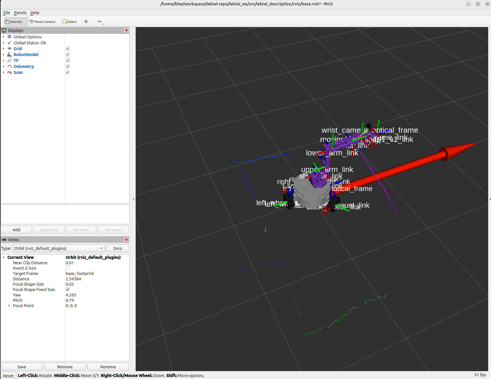
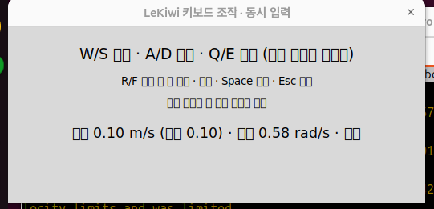
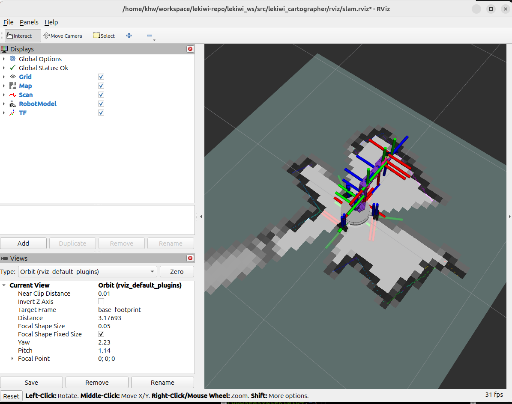
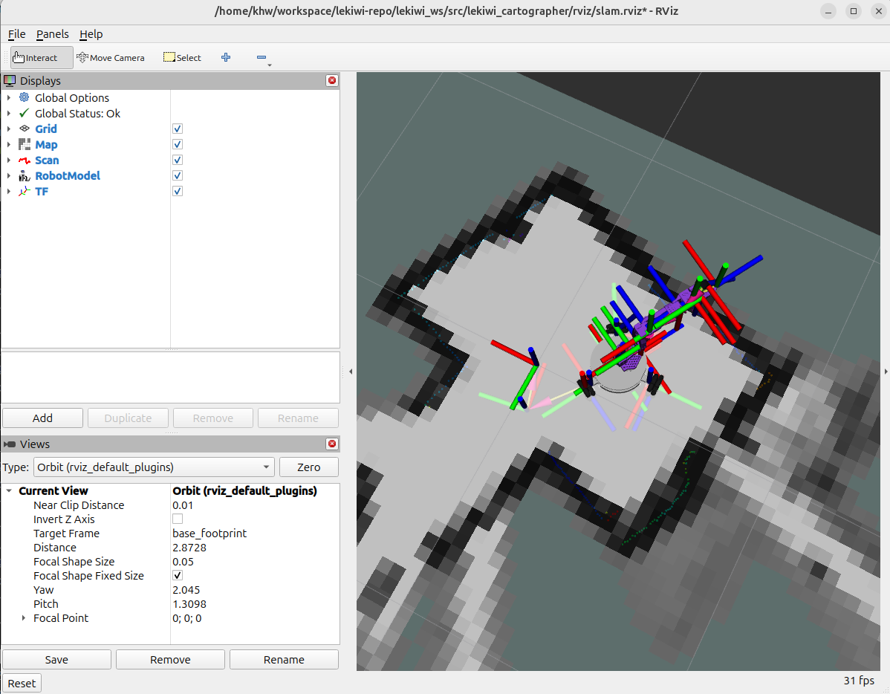
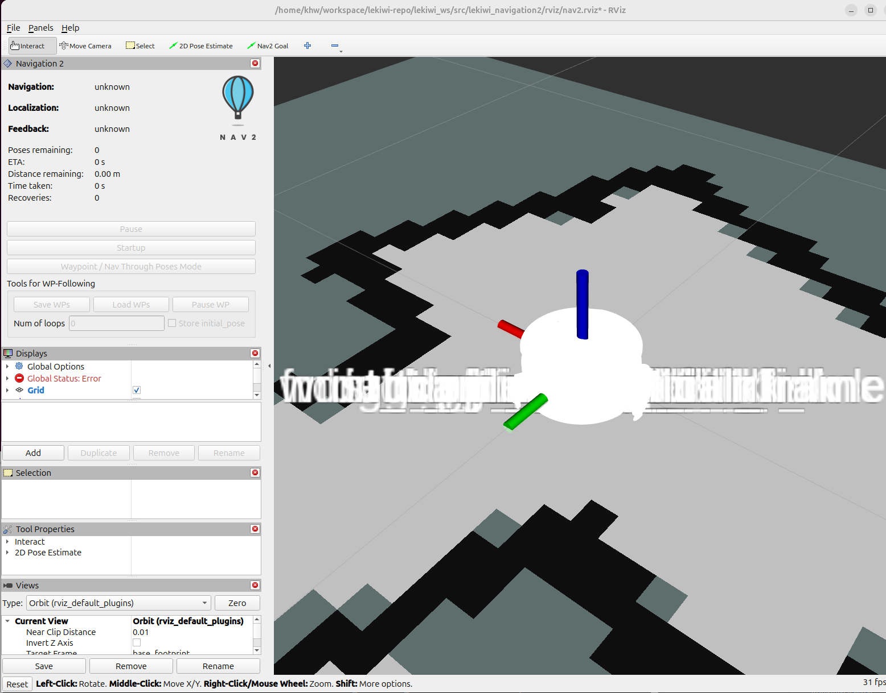
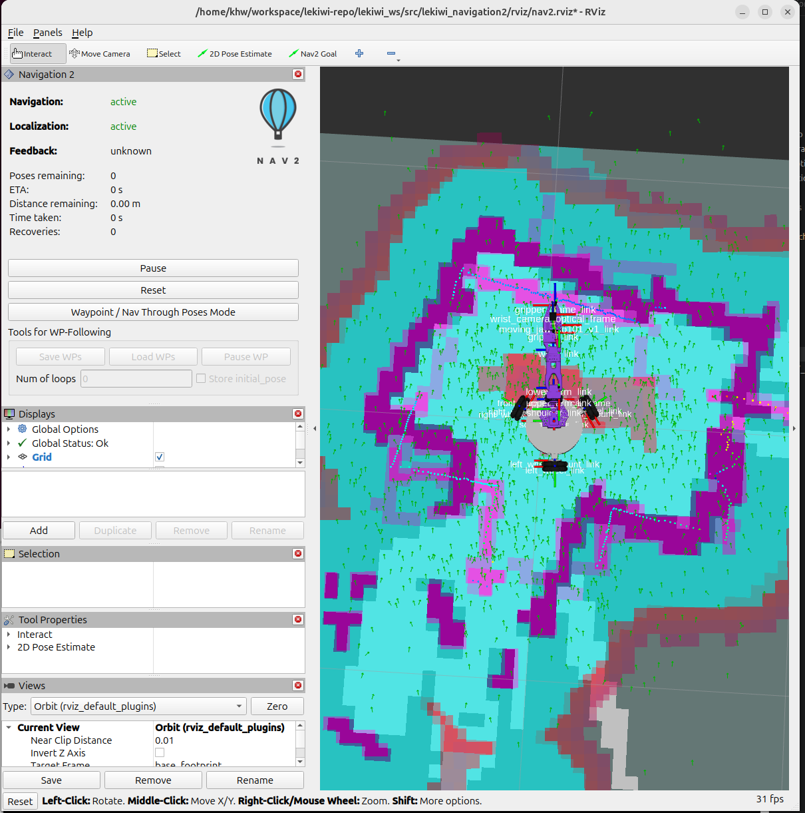
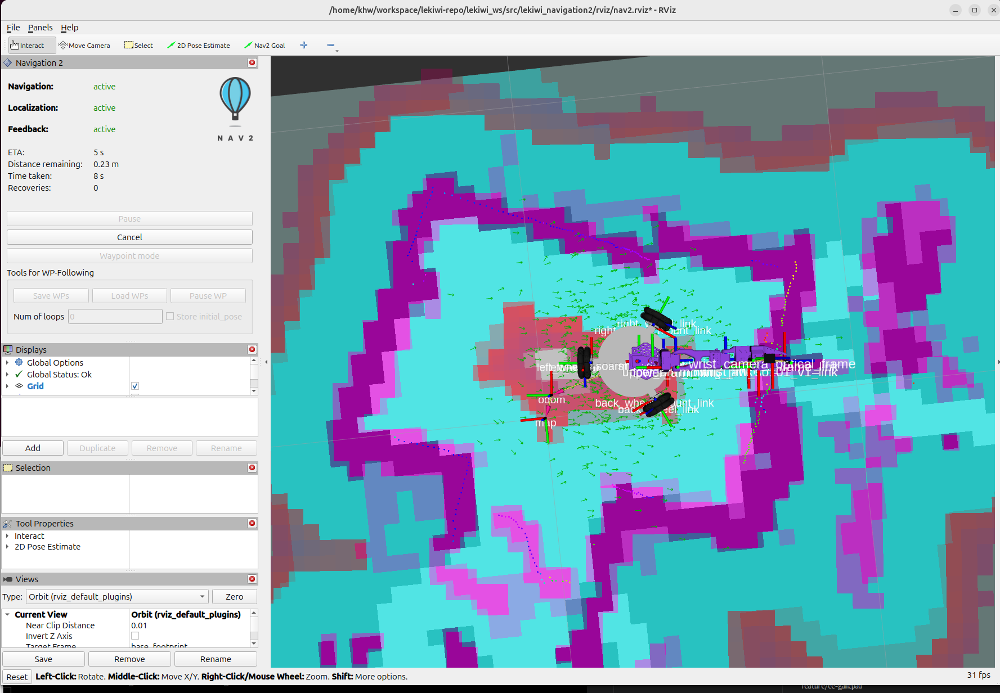

# LeKiwi 온디바이스 워크스페이스

LeKiwi Raspberry Pi(`~/lekiwi_ws`)에서 실행하는 ROS 2 패키지 모음. 센서 · 모터부터 지도 · 자율 주행 · 조작까지 **모두 Pi에서 돌고, PC는 RViz로 보기만 한다.**
**하드웨어를 직접 읽는 낮은 계층**과 **그 토픽만 쓰는 높은 계층**을 나눈다.

- 대상: Raspberry Pi 4 · Ubuntu 24.04 · ROS 2 Jazzy (PC도 Ubuntu 24.04 · Jazzy)
- 노드 · 토픽 · 서비스 · 프레임 이름: [docs/interfaces.md](docs/interfaces.md)
- 실물 확인 순서와 통과 기준: [docs/field_validation.md](docs/field_validation.md)
- 카메라 영상 보기: [docs/camera.md](docs/camera.md)
- 이 저장소 `feature/lekiwi-ros2` 브랜치의 검증된 코드 · 설정 · 안전 처리를 이 구조로 옮겼다

**목차**

- [계층 구조](#계층-구조) · [현재 상태](#현재-상태)
- [사용 설명서: PC에서 보고 조작하기](#사용-설명서-pc에서-보고-조작하기)
  1. [처음 한 번만 준비 (PC)](#1-처음-한-번만-준비-pc)
  2. [매번 하는 순서](#2-매번-하는-순서)
  3. [RViz 화면 읽는 법](#3-rviz-화면-읽는-법)
  4. [1단계 확인: 스캔 방향](#4-1단계-확인-스캔-방향이-실제와-맞는지)
  5. [문제 해결](#5-문제-해결)
  6. [`ros2 run`으로 하나씩 실행하기 · 키보드 주행](#6-launch-대신-ros2-run으로-하나씩-실행하기)
  7. [지도 만들기 (Cartographer)](#7-지도-만들기-cartographer)
  8. [저장 지도로 자율 주행 (Nav2)](#8-저장-지도로-자율-주행-nav2)
  9. [다음 단계](#9-다음-단계)
- [개발 참고](#개발-참고): 원칙, 만들지 않은 계층, 빌드, git, 백업

---

## 계층 구조

```text
PC (보기만 한다)
  RViz                   로봇 · 지도 · 경로 보기, 초기 위치 · 목표 지정 (Nav2 감독 도구가 지켜보는 조작 화면)
        │ 초기 위치 · 목표 ↓                ↑ map · scan · TF · 경로      (키보드 조작 창은 Pi에서 돌고 ssh -X로 PC에 뜬다)
Raspberry Pi
  필요할 때 따로 실행
  lekiwi_teleop          키보드 조작 · 짧은 명령 · 거리 시험 · Nav2 감독
  lekiwi_cartographer    지도 작성 → map → odom
  lekiwi_navigation2     저장 지도 · AMCL · MPPI Omni · 충돌 감시 → cmd_vel
        │ cmd_vel ↓                         ↑ odom · scan · imu · TF
  lekiwi_bringup이 실행
  lekiwi_motor/
    lekiwi_base_controller   cmd_vel → 바퀴 속도, 바퀴 → odom, 모터 안전 상태기계
    lekiwi_motor_driver      Feetech 버스(/dev/ttyACM0)를 여는 유일한 노드. 모터 9개 읽기, 바퀴 3개 쓰기
  lekiwi_sensor/
    lekiwi_imu  lekiwi_lidar  lekiwi_scan_filter  lekiwi_camera
  lekiwi_description         URDF · 메시 → robot_state_publisher

lekiwi_msgs                  모든 커스텀 msg/srv/action
```

## 현재 상태

| 패키지 | 실행 위치 | 상태 |
|--------|----------|------|
| `lekiwi_msgs` | 양쪽 | `MotorState`, `MotorStateArray`, `WheelCommand`. Pi · PC 빌드 확인 |
| `lekiwi_motor/lekiwi_motor_driver` | Pi | 2026-10-17 실물 읽기 확인. 2026-10-18 바퀴 쓰기 · 안전 감시 추가, 가상 버스 시험 통과. 2026-10-18 키보드로 실물 주행 확인 |
| `lekiwi_motor/lekiwi_base_controller` | Pi | 2026-10-18 `lekiwi_node`의 기구학 · odom · 안전 상태기계를 옮김. 단위 · 통합 시험 통과. 2026-10-18 키보드로 w/s/a/d/q/e 실물 주행 확인 (odom 정확도는 3단계) |
| `lekiwi_sensor/lekiwi_imu` | Pi | 2026-10-17 실행 확인. 2026-10-18 bringup에서 100 Hz 확인, 필터를 새로 쓰고 시험 8개 추가 |
| `lekiwi_sensor/lekiwi_lidar` | Pi | 2026-10-18 bringup에서 10 Hz 확인 (Tmini Plus). 실제 물체와 방향 일치는 미확인 |
| `lekiwi_sensor/lekiwi_scan_filter` | Pi | 2026-10-18 실물 스캔 10 Hz, 자기 반사(0.19 m 안) 제거 확인 |
| `lekiwi_sensor/lekiwi_camera` | Pi | 2026-10-18 전방 · 손목 영상을 PC에서 확인 ([docs/camera.md](docs/camera.md)) |
| `lekiwi_description` | 양쪽 | 2026-10-18 옮김. Pi에서 xacro · TF 확인 |
| `lekiwi_bringup` | Pi · PC | 2026-10-18 작성. 1단계(움직임 없음) 실물 기동 확인. 관절 발행 10 Hz로 낮춤 (Nav2 함께 실행) |
| `lekiwi_teleop` | Pi | 2026-10-18 옮김 · 터미널 · 동시 입력 키보드 조작 추가. 시험 179개 통과. 터미널 · 동시 입력 창으로 실물 주행, Nav2 감독 도구 토크 켜기 확인 |
| `lekiwi_cartographer` | Pi | 2026-10-18 Pi에서 키보드로 주행하며 지도 작성 · 저장 확인 (좁은 공간) |
| `lekiwi_navigation2` | Pi | 2026-10-18 Pi에서 목표 0.49 m · 0.75 m 도착 확인 (좁은 지도). RViz 닫힘 정지 · 충돌 감시 미확인 |

다음 할 일: [현장 확인 절차](docs/field_validation.md) 5단계의 남은 확인(RViz 닫으면 토크 끔, 상자 앞 충돌 감시 정지), 넓은 공간에서 4 · 5단계 다시.
그 뒤 팔 관절 각도 발행, ros2_control 전환 검토.

---

## 사용 설명서: PC에서 보고 조작하기

PC에서 **LeKiwi가 보고 있는 것**(로봇 모델, 라이다 스캔, 위치, 지도)을 RViz로 보고, 키보드 · Nav2로 움직이는 방법.

- 로봇 코드는 **Raspberry Pi**(`~/lekiwi_ws`)에서 빌드하고 실행한다. PC는 화면만 보여 준다.
- Pi에서 노드를 launch 없이 하나씩 켜는 방법은 [6장](#6-launch-대신-ros2-run으로-하나씩-실행하기)에 있다.
- PC에서는 RViz가 로봇 모양(메시 파일)을 찾을 수 있도록 **모델 패키지 `lekiwi_description` 하나만** 빌드한다.
- 대상: Ubuntu 24.04 · ROS 2 Jazzy PC, 같은 네트워크의 LeKiwi (예: `lekiwi04`)



*2026-10-18 lekiwi04에서 본 정상 화면: 로봇 모델, 프레임 축(TF), 로봇 앞 방향을 가리키는 큰 빨간 화살표(odom), 주변 벽에 찍힌 스캔 점*

---

### 1. 처음 한 번만 준비 (PC)

#### ① colcon 설치 (비밀번호 필요)

```bash
sudo apt install ros-dev-tools
```

#### ② 저장소 받기 · 모델 패키지만 빌드

PC 작업 폴더를 하나 정해 `LEKIWI_WS`로 부른다. **이 저장소가 그 안의 `src`가 된다.** 아래 명령은 모두 이 이름을 쓴다.

```bash
export LEKIWI_WS=~/lekiwi_ws        # PC 작업 폴더. 예: ~/workspace/lekiwi-repo/lekiwi_ws
git clone -b feature/ros2-on-device https://github.com/roboseasy-members/lekiwi.git $LEKIWI_WS/src
cd $LEKIWI_WS
colcon build --symlink-install --packages-select lekiwi_description
```

`Summary: 1 package finished`가 나오면 된다. 모델이 바뀌었을 때만 다시 빌드한다.
이미 받아 둔 사본이 있으면 `git clone` 대신 `git -C $LEKIWI_WS/src pull`만 한다.

---

### 2. 매번 하는 순서

#### ① Pi에서 로봇 켜기

PC에서 Pi로 접속한 터미널(또는 Pi 터미널)에서 실행한다.

```bash
ssh roboseasy@lekiwi04.local
ros2 launch lekiwi_bringup bringup.launch.py
```

바퀴 토크는 꺼진 채로 시작한다. 이 터미널은 켜 둔다. 끌 때는 `Ctrl+C`.

#### ② PC 새 터미널에서 환경 설정

**새 터미널을 열 때마다** 네 줄을 입력한다. 도메인 번호는 Pi와 같아야 한다.

```bash
export LEKIWI_WS=~/lekiwi_ws        # 1-②에서 정한 PC 작업 폴더
source $LEKIWI_WS/install/setup.bash
export ROS_DOMAIN_ID=42
export ROS_AUTOMATIC_DISCOVERY_RANGE=SUBNET
```

매번 치기 번거로우면 네 줄을 `~/.bashrc` 끝에 붙여 둔다.

#### ③ RViz 열기

```bash
rviz2 -d $LEKIWI_WS/src/lekiwi_description/rviz/base.rviz
```

#### ④ (선택) 연결 확인

RViz가 비어 보이면 같은 설정의 다른 PC 터미널에서 확인한다.

```bash
ros2 node list                                  # /lekiwi_lidar_node 등이 보이는지
ros2 topic hz /lekiwi/sensor/scan_filtered      # 약 10 Hz
```

---

### 3. RViz 화면 읽는 법

#### 왼쪽 Displays 패널

| 항목 | 보여 주는 것 | 데이터 출처 (Pi) |
|------|-------------|------------------|
| Grid | 바닥 격자 (한 칸 1 m) | — |
| RobotModel | 로봇 몸체 · 바퀴 · 팔 모양 | `robot_state_publisher` (`/robot_description`) |
| TF | 각 부품의 좌표축과 이름 | `/tf`, `/tf_static` |
| Odometry | 큰 빨간 화살표: 로봇 위치와 **앞 방향** | 베이스 컨트롤러 `/odom` |
| Scan | 라이다 점 (로봇 몸체 반사를 뺀 것) | 스캔 필터 `/lekiwi/sensor/scan_filtered` |

오른쪽 아래 `Global Status: Ok`면 정상이다. 빨간 글씨가 보이면 [5. 문제 해결](#5-문제-해결)을 본다.

#### 좌표축 색

| 색 | 축 | 로봇 기준 방향 |
|----|----|----------------|
| 빨강 | x | **앞** (전방 카메라 쪽) |
| 초록 | y | **왼쪽** |
| 파랑 | z | 위 |

#### 스캔 점 색

점 색은 반사 세기(intensity)다. 방향 · 거리와는 상관없다.

#### 마우스

| 동작 | 결과 |
|------|------|
| 왼쪽 드래그 | 회전 |
| 가운데(휠) 드래그 | 이동 |
| 휠 / 오른쪽 드래그 | 확대 · 축소 |

#### 화면이 복잡할 때

- 프레임 이름이 겹쳐 보이면: Displays → `TF` 펼치기 → `Show Names` 체크 해제
- 축이 너무 많으면: `TF` 체크 해제 (모델 · 스캔만 보기)
- 설정을 바꾼 뒤 저장하고 싶으면 `File → Save Config As`로 **다른 이름**에 저장한다 (원본 `base.rviz`는 git 파일이다)

---

### 4. 1단계 확인: 스캔 방향이 실제와 맞는지

로봇은 움직이지 않는다. 확인한 날짜와 결과를 아래 표에 적는다.

- [ ] 로봇 모델이 보이고 `Global Status: Ok`다
- [ ] 스캔 점이 실제 벽 · 가구 모양과 비슷하게 둘러싼다
- [ ] 로봇 **앞쪽**(전방 카메라 쪽)에 상자를 두면, RViz에서 **빨간 축(x) 방향**에 점이 생긴다
- [ ] 상자를 로봇 **왼쪽**으로 옮기면 점이 **초록 축(y) 방향**으로 옮겨 간다
- [ ] 로봇 바로 옆(약 19 cm 안)의 점은 보이지 않는다 (로봇 몸체 반사를 일부러 뺀다)

| 날짜 | 로봇 | 결과 | 확인한 사람 |
|------|------|------|-------------|
| 2026-10-18 | lekiwi04 | 로봇 모델 · TF · odom · 스캔 표시 확인. 상자로 방향 확인은 아직 | |

방향이 반대로 보이면 바로 다음 단계로 가지 말고 기록해 둔다. 라이다 장착 방향 설정(`lekiwi_lidar` · URDF)을 고쳐야 한다.

---

### 5. 문제 해결

#### Pi 터미널에 보이는 라이다 메시지

bringup을 켜면 라이다(YDLidar SDK)가 처음에 이런 줄을 낼 수 있다.

```text
[error] Checksum error 0xD468 != 0xD5E5
[warn] [YDLIDAR]: Real points 440 > fixed points 430
[warn] [YDLIDAR]: Real points 698 > fixed points 430
```

| 메시지 | 뜻 | 조치 |
|--------|----|------|
| `Checksum error` | 회전이 안정되기 전에 들어온 첫 패킷 하나가 깨졌다. SDK가 그 패킷만 버린다 | 시작할 때 몇 줄이면 정상 |
| `Real points N > fixed points 430` | 한 바퀴에 들어온 점이 고정 배열(430칸)보다 많아 남는 점을 버렸다. 시작할 때는 반 바퀴가 겹쳐 698처럼 크게 나온다 | 시작할 때 몇 줄이면 정상 |

2026-10-18 lekiwi04에서 이 메시지가 나온 뒤에도 스캔은 10.03 Hz, 매번 430점으로 정상이었다 (자기 반사 제거 후 257~266점).
**몇 분이 지나도 계속 올라오면** USB 케이블 · 전원을 의심한다.

#### RViz 증상별

| 증상 | 원인 · 조치 |
|------|------------|
| 로봇 모델이 하얗거나 `RobotModel` 빨간 오류 (`Could not load resource package://lekiwi_description/...`) | PC 터미널에서 `source $LEKIWI_WS/install/setup.bash`를 하지 않았거나 `lekiwi_description`을 빌드하지 않음. 1-②, 2-② 확인 |
| 모델도 스캔도 안 보임 | Pi bringup이 꺼짐, 또는 PC · Pi의 `ROS_DOMAIN_ID`가 다름. 두 쪽 모두 `42`인지 확인 |
| `Fixed Frame [odom] does not exist` | 베이스 컨트롤러 없이 켬(`use_base_controller:=false`). 왼쪽 `Global Options → Fixed Frame`을 `base_footprint`로 바꾼다 |
| 스캔만 안 보임 | Pi 터미널에 `YDLIDAR ready`가 나왔는지 확인. `ros2 topic hz /lekiwi/sensor/scan_filtered` |
| `ros2 node list`가 비어 있는데 RViz는 보임 | 예전 설정으로 떠 있는 ROS 데몬. `ros2 daemon stop` 후 다시 실행 |
| 스캔이 몇 초 늦게 따라옴 · 끊김 | Wi-Fi가 약함. 로봇을 공유기 가까이 두거나 유선 연결 |
| 팔이 실제와 다른 자세로 보임 | 정상. 팔 관절 각도는 아직 보내지 않아 0으로 그린다 |

---

### 6. launch 대신 `ros2 run`으로 하나씩 실행하기

`ros2 launch lekiwi_bringup bringup.launch.py`가 한 번에 켜는 노드들을 **하나씩 따로** 켜는 방법이다.
노드 하나만 시험하거나, 어느 노드가 문제인지 찾을 때 쓴다.

Pi 워크스페이스에서 `ros2 run`으로 실행할 수 있는 것은 **16개**(로봇 노드 7개 + 도구 9개)이고, bringup이 함께 쓰는 apt 노드가 2개 더 있다.
목록은 언제든 `ros2 pkg executables | grep lekiwi`로 다시 볼 수 있다.

#### 먼저 알아 둘 것

- **`ros2 run`은 설정 파일(`config/*.yaml`)을 자동으로 읽지 않는다.** 아래 명령처럼 `--params-file`로 넣어야 bringup과 같은 값으로 뜬다.
  특히 **베이스 컨트롤러는 설정 파일 없이 켜면 mock(가짜 모터)**으로 뜬다.
- **bringup이 켜져 있으면 먼저 끈다 (`Ctrl+C`).** 같은 노드가 두 개가 되고, 모터 드라이버는 `Device or resource busy`로 실패한다.
- 노드마다 **터미널을 하나씩** 쓴다. 각 터미널에서 `source ~/lekiwi_ws/install/setup.bash`가 되어 있어야 한다 (Pi `.bashrc`가 해 준다).
- 장비 프로파일(`~/lekiwi_ws/robot_profile.yaml`)을 만들었다면 명령 끝에 `--params-file ~/lekiwi_ws/robot_profile.yaml`을 하나 더 붙인다. bringup은 이것을 자동으로 붙인다.
- `$(ros2 pkg prefix --share <패키지>)`는 그 패키지의 설치 폴더(`~/lekiwi_ws/install/<패키지>/share/<패키지>`)로 바뀐다.

#### 6-1. 로봇 노드 (Pi, bringup 순서)

| # | 노드 | 하는 일 | 바퀴 움직임 |
|---|------|---------|:---:|
| 1 | `robot_state_publisher` (apt) | URDF → 로봇 몸체 TF | 없음 |
| 2 | `joint_state_publisher` (apt) | 바퀴 관절 + 팔 관절(0)을 합쳐 `/joint_states` | 없음 |
| 3 | `lekiwi_imu_node` | BMI160 IMU 100 Hz | 없음 |
| 4 | `lekiwi_lidar_node` | YDLIDAR 스캔 10 Hz | 없음 (라이다만 돎) |
| 5 | `lekiwi_scan_filter_node` | 로봇 몸체 반사 제거 | 없음 |
| 6 | `lekiwi_camera_node` ×2 | 전방 · 손목 카메라 | 없음 |
| 7 | `lekiwi_motor_driver_node` | 모터 버스. 기본은 읽기 전용 | 기본 없음 |
| 8 | `lekiwi_base_controller_node` | `cmd_vel` → 바퀴, 바퀴 → `odom` | 토크는 꺼진 채 시작 |

**1. robot_state_publisher**

```bash
ros2 run robot_state_publisher robot_state_publisher --ros-args \
  -p robot_description:="$(xacro $(ros2 pkg prefix --share lekiwi_description)/urdf/lekiwi.urdf.xacro use_hardware_sensors:=true)"
```

**2. joint_state_publisher**

```bash
ros2 run joint_state_publisher joint_state_publisher --ros-args \
  -p source_list:="['lekiwi/motor/wheel_joint_states']" -p zeros.wrist_roll:=-1.5707963267948966
```

**3. IMU** — 켜고 2초 동안 로봇을 가만히 둔다 (자이로 보정 중)

```bash
ros2 run lekiwi_imu lekiwi_imu_node --ros-args \
  --params-file $(ros2 pkg prefix --share lekiwi_imu)/config/lekiwi_imu.yaml
```

**4. 라이다**

```bash
ros2 run lekiwi_lidar lekiwi_lidar_node --ros-args \
  --params-file $(ros2 pkg prefix --share lekiwi_lidar)/config/lekiwi_lidar.yaml
```

**5. 스캔 필터** — 라이다가 켜져 있어야 출력이 나온다

```bash
ros2 run lekiwi_scan_filter lekiwi_scan_filter_node --ros-args \
  --params-file $(ros2 pkg prefix --share lekiwi_scan_filter)/config/lekiwi_scan_filter.yaml
```

**6. 카메라** — 설정이 노드 이름별로 나뉘어 있어서 `__node`로 이름을 준다. 영상 보기는 [docs/camera.md](docs/camera.md)

```bash
# 전방
ros2 run lekiwi_camera lekiwi_camera_node --ros-args -r __node:=front_camera_node \
  --params-file $(ros2 pkg prefix --share lekiwi_camera)/config/lekiwi_camera.yaml
# 손목
ros2 run lekiwi_camera lekiwi_camera_node --ros-args -r __node:=wrist_camera_node \
  --params-file $(ros2 pkg prefix --share lekiwi_camera)/config/lekiwi_camera.yaml
```

**7. 모터 드라이버**

```bash
# 읽기 전용 (모터 9개 상태만. 토크 · 속도를 쓰지 않는다)
ros2 run lekiwi_motor_driver lekiwi_motor_driver_node --ros-args \
  --params-file $(ros2 pkg prefix --share lekiwi_motor_driver)/config/lekiwi_motor_driver.yaml

# 바퀴 쓰기 열기 (8번 베이스 컨트롤러와 함께 쓸 때). 시작할 때 바퀴 속도 0 · 토크 끔을 한 번 쓴다
ros2 run lekiwi_motor_driver lekiwi_motor_driver_node --ros-args \
  --params-file $(ros2 pkg prefix --share lekiwi_motor_driver)/config/lekiwi_motor_driver.yaml \
  -p wheel_write_enabled:=true
```

**8. 베이스 컨트롤러** — 7번을 `wheel_write_enabled:=true`로 켠 뒤에 켠다. 설정 파일 두 개를 이 순서로 넣는다

```bash
ros2 run lekiwi_base_controller lekiwi_base_controller_node --ros-args \
  --params-file $(ros2 pkg prefix --share lekiwi_base_controller)/config/lekiwi_base_controller.yaml \
  --params-file $(ros2 pkg prefix --share lekiwi_description)/config/base_frame.yaml
```

켜기만 해서는 바퀴가 움직이지 않는다. 토크는 아래 도구가 `lekiwi/motor/power`를 불러야 켜진다.

#### 6-2. 도구 (`lekiwi_teleop`, `lekiwi_cartographer`)

옵션은 `ros2 run <패키지> <실행 파일> --help`로 본다.

| 실행 파일 | 어디서 | 바퀴 움직임 | 용도 |
|-----------|--------|:---:|------|
| `lekiwi_teleop lekiwi_safe_cmd_vel` | Pi · PC 터미널 | ⚠️ `--arm-motors`일 때만 | 정해진 시간만 속도 명령. 2단계 바퀴 시험용 |
| `lekiwi_teleop lekiwi_keyboard_teleop` | **Pi (`ssh -X`)** · 그래픽 창이 뜨는 곳 | ⚠️ 켬 → 끝나면 끔 | **권장.** 키 동시 입력(w+d 대각선), 빠른 가속. 아래 6-3 |
| `lekiwi_teleop lekiwi_terminal_teleop` | **Pi SSH 터미널** · 어느 터미널이든 | ⚠️ 켬 → 끝나면 끔 | 터미널에서 키를 누르고 있는 동안만 움직임 (동시 입력 불가). 아래 6-4 |
| `lekiwi_teleop lekiwi_guarded_base_teleop` | **PC** (그래픽 창 필요) | ⚠️ 켬 → 끝나면 끔 | 키를 누르는 동안만 움직이는 조작 창 (w/s/a/d/q/e) |
| `lekiwi_teleop lekiwi_distance_trial` | Pi · PC 터미널 | ⚠️ `run`일 때만 | 20 cm 직선 시험: `plan` → `run` → `compare` |
| `lekiwi_teleop lekiwi_odom_calibration` | 어디서나 (ROS 연결 없음) | 없음 | 거리 시험 결과로 `encoder_odom_scale` 계산 |
| `lekiwi_teleop lekiwi_nav2_motor_guard` | Pi (보통 Nav2 launch가 실행) | ⚠️ Nav2 주행 중 켬 | PC RViz가 떠 있는 동안에만 토크 유지. 아래 8장 |
| `lekiwi_teleop lekiwi_base_teleop` | 터미널 | 없음 | **mock 베이스 전용** 데모. 실물에는 쓰지 않는다 |
| `lekiwi_cartographer save_map.sh` | Pi (Cartographer와 같은 곳) | 없음 | 지도 저장 (`~/maps/lekiwi/`). 아래 7장 |

`lekiwi_safe_cmd_vel`은 옵션 없이 실행하면 **속도 0만 보내고 끝나서** 안전하게 연습해 볼 수 있다.

```bash
ros2 run lekiwi_teleop lekiwi_safe_cmd_vel
```

#### 6-3. 키보드 동시 입력으로 주행하기 (`lekiwi_keyboard_teleop`, 권장)

`w`+`d`(대각선), `w`+`q`(앞으로 가며 회전)처럼 **여러 키를 함께** 누를 수 있다. Pi에서 실행한 창이 `ssh -X`로 노트북 화면에 뜬다.
터미널 방식(6-4)은 터미널이 마지막 키 하나만 반복해 보내서 동시 입력을 할 수 없다.

**터미널 1 · 2 (Pi):** bringup, 또는 6-1의 모터 드라이버 + 베이스 컨트롤러를 켜 둔다.

**터미널 3 (노트북 → Pi, `-X` 필수)**

```bash
ssh -X roboseasy@lekiwi04.local
ros2 run lekiwi_teleop lekiwi_keyboard_teleop --yes-i-confirm-motion
```

노트북에 `LeKiwi 키보드 조작 · 동시 입력` 창이 뜬다. **창을 한 번 클릭해 선택**한 뒤 키를 누른다.

| 키 | 동작 (누르고 있는 동안만, 함께 누르면 합쳐서) |
|---|---|
| `w` / `s` | 앞 / 뒤 |
| `a` / `d` | 왼쪽 / 오른쪽 옆걸음 |
| `q` / `e` | 좌회전 / 우회전 |
| `w`+`d` 등 | 대각선 (같은 속도) |
| `w`+`q` 등 | 앞으로 가며 회전 |
| `r` / `f` | 속도 한 칸 올림 / 내림 (0.01 ~ 0.20 m/s, 베이스 상한 안까지). 시작은 0.10 |
| `Space` | 즉시 정지 |
| `Esc` 또는 창 닫기 | 정지 → 토크 끄고 종료 |

- 0.5초 안에 설정 속도에 이르고, 키를 모두 떼면 바로 멈춘다. 창 밖을 누르면 멈춘다.
- 이 도구는 기본으로 최고 0.10 m/s다 (`--max-linear` 기본 0.10, `--max-angular` 기본 0.75. 예전 베이스 상한에서 쓰던 최고 단계). 베이스 상한은 2026-10-22부터 0.23 m/s · 1.53 rad/s(88°/s)(텔레오퍼레이션 화면용. 사용자 요청 0.3 m/s · 90°/s를 바퀴 상한 tick 3000에 맞춘 값)라, `--max-linear 0.2 --max-angular 1.2`를 주면 20단계(0.20 m/s)까지 쓴다. 베이스 상한을 바꿀 때는 베이스 컨트롤러 · 모터 드라이버 값을 짝으로 맞춘다 (`max_linear_*`, `max_angular_z`, `max_wheel_speed` ↔ `speed_tick_limit`).
- 창이 안 뜨고 `couldn't connect to display`가 나오면 `-X` 없이 접속한 것이다. `echo $DISPLAY`가 `localhost:10.0`처럼 나와야 한다. 안 되면 `ssh -Y`로 접속한다.
- 창의 **한글이 네모(□)로 나오면** Pi에 한글 글꼴이 없는 것이다. 창은 Pi가 그려서 노트북으로 보낸다. Pi에서 한 번 설치하고 창을 다시 켠다 (lekiwi04는 2026-10-18 설치함).

  ```bash
  sudo apt install fonts-nanum
  ```

  

  *2026-10-18 lekiwi04, 글꼴 설치 전: 글자는 깨졌지만 조작은 된다. 아래 줄은 `속도 0.10 m/s (최고 0.10) · 회전 0.58 rad/s · 정지`다.
  bringup 기본 상한(0.10 m/s)으로 켜서 최고가 0.10이다.*

#### 6-4. Pi 터미널에서 키보드로 주행하기 (`lekiwi_terminal_teleop`)

PC에서 Pi에 SSH로 접속한 터미널 두 개만 있으면 된다. PC에 ROS 설정이 필요 없다.

**터미널 1 (Pi): 로봇 켜기**

```bash
ssh roboseasy@lekiwi04.local
ros2 launch lekiwi_bringup bringup.launch.py
```

**터미널 2 (Pi): 키보드 조작**

```bash
ssh roboseasy@lekiwi04.local
ros2 run lekiwi_teleop lekiwi_terminal_teleop --yes-i-confirm-motion
```

`속도 0.04 m/s (최고 0.10) · 회전 0.23 rad/s · 정지`가 보이면 준비 완료다. 이 터미널 창을 선택한 상태에서 키를 누른다.

| 키 | 동작 (누르고 있는 동안만) |
|---|---|
| `w` / `s` | 앞 / 뒤 |
| `a` / `d` | 왼쪽 / 오른쪽 옆걸음 |
| `q` / `e` | 좌회전(반시계) / 우회전(시계) |
| `r` / `f` | 속도 한 칸 올림 / 내림 (0.01 ~ 0.20 m/s, 0.01 간격 20단계). 누르고 있으면 0.2초마다 한 칸. 베이스 상한과 `--max-linear` · `--max-angular`(기본 0.10 m/s · 0.75 rad/s) 안까지만 (기본 최고 0.10) |
| `1` / `2` / `3` | 속도 바로 고르기: 0.04 / 0.05 / 0.06 m/s (시작은 0.04) |
| `Space` | 즉시 정지 |
| `Esc` 또는 `Ctrl+C` | 정지 → 토크 끄고 종료 |

- 키를 떼면 **0.6초 안에** 멈춘다. 터미널은 키를 뗀 순간을 알려 주지 않아서, 반복 입력이 0.6초 끊기면 뗀 것으로 본다.
- SSH 연결이 끊기면 스스로 정지하고 토크를 끈다. 프로세스가 강제로 죽어도 베이스 컨트롤러가 0.3초 안에 멈춘다.
- 한글 입력 상태면 키가 영문으로 들어가지 않는다. 영문 입력 상태로 둔다.

**처음에는 바퀴를 띄운 상태에서** 아래처럼 도는지 본다. 바퀴는 정삼각형으로, 전방 카메라 쪽에 두 개, 반대쪽(뒤)에 한 개다.

| 키 | 정상이면 |
|---|---|
| `w` (앞) | 뒤쪽 바퀴는 거의 안 돌고, 앞쪽 두 바퀴가 서로 반대 방향으로 돈다 |
| `a` (왼쪽) | 세 바퀴가 모두 돌고, 뒤쪽 바퀴가 가장 빠르다 |
| `q` (좌회전) | 세 바퀴가 모두 같은 방향으로 같은 속도로 돈다 |

다르면 `Esc`로 끄고, 어느 키에서 어떻게 돌았는지 기록한다 (바퀴 ID · 방향 설정을 고쳐야 한다).

**참고: 표준 `teleop_twist_keyboard`로 하는 방법** — 키보드 노드를 따로 쓰고, 토크는 직접 켜고 끈다.

```bash
sudo apt install ros-jazzy-teleop-twist-keyboard          # 한 번만
ros2 service call /lekiwi/motor/power std_srvs/srv/SetBool "{data: true}"
ros2 run teleop_twist_keyboard teleop_twist_keyboard --ros-args -p speed:=0.1 -p turn:=0.5   # i/,: 앞뒤, j/l: 회전, Shift+J/L: 옆걸음
ros2 service call /lekiwi/motor/power std_srvs/srv/SetBool "{data: false}"   # 끝나면 꼭
```

이 방법은 키를 누를 때만 명령을 보내서, 키를 처음 누를 때 베이스 컨트롤러의 0.3초 timeout에 걸려 한 번 멈칫한다.
기본 속도(0.5 m/s · 1.0 rad/s)는 베이스 상한(0.23 m/s · 1.53 rad/s) 가까이 빠르므로 위처럼 `speed:=0.1 turn:=0.5`로 낮춰 띄운다 (q/z로 바꾸지 않는다). 실물 주행에는 `lekiwi_keyboard_teleop`이나 `lekiwi_terminal_teleop`을 쓴다.

⚠️ 표시된 도구로 바퀴를 실제로 돌리는 것은 **바퀴를 띄운 2단계에서만** 한다. 순서는 [docs/field_validation.md](docs/field_validation.md).

---

### 7. 지도 만들기 (Cartographer)

지도는 **Pi가 만들고 Pi에 저장**한다. PC는 RViz로 지도가 그려지는 것을 본다.
⚠️ 키보드로 로봇을 움직인다. 주변에 사람 · 케이블이 없는지, **즉시 주 전원을 끌 사람이 옆에 있는지** 확인한다.

**① Pi 터미널 1: bringup** (이미 켜져 있으면 `Ctrl+C`로 끄고 다시 켠다. 2026-10-18에 관절 발행을 10 Hz로 낮췄다)

```bash
ros2 launch lekiwi_bringup bringup.launch.py
```

**② Pi 터미널 2: 지도 작성 시작**

```bash
ros2 launch lekiwi_cartographer cartographer.launch.py
```

15초쯤 뒤 아래 세 줄이 보이면 센서를 모두 받고 있는 것이다. 시작하고 몇 초는 로봇을 가만히 둔다.

```text
imu rate: 100.00 Hz ...
odom rate: 50.00 Hz ...
scan rate: 10.01 Hz ...
```

**③ PC 새 터미널: 지도 그려지는 과정 보기** (2-②의 환경 설정 네 줄 후)

```bash
rviz2 -d $LEKIWI_WS/src/lekiwi_cartographer/rviz/slam.rviz
```



*2026-10-18 lekiwi04에서 로봇을 세워 둔 채 지도 작성을 시작한 화면: 로봇 주변 2 ~ 3 m만 그려져 있다*

| 화면 | 뜻 |
|---|---|
| 흰색 칸 | 비어 있다고 확인된 바닥 |
| 검은색 칸 | 벽 · 물체 |
| 회색 | 아직 못 본 곳 |
| 점 | 지금 라이다가 보는 것 (색은 반사 세기) |
| 로봇 모델 | 지도 위 현재 위치 |

- 지도는 1초마다 다시 그려진다. 로봇이 움직이면 흰색 · 검은색이 넓어진다.
- 흰 영역이 **십자 모양**인 것은 정상이다. 라이다가 몸체 아래에 거꾸로 달려 바퀴 쪽이 가려지고, 바퀴 사이로만 멀리 본다. 움직이면 가려진 곳도 채워진다.
- 지도가 로봇 시작 방향보다 **90° 돌아** 보이는 것도 정상이다. 지도 원점을 IMU 방향에 맞추기 때문이다 (주행에는 영향 없음).
- 색깔 막대(좌표축)가 많아 복잡하면 왼쪽 `TF` 체크를 끈다.
- 화면이 비어 있으면 왼쪽 위 `Fixed Frame`이 `map`인지 본다. 몇 초 기다려도 비어 있으면 RViz를 닫았다 다시 연다.

**④ 노트북 새 터미널 → Pi: 천천히 주행** (6-3 키보드 창)

⚠️ 로봇이 바닥에 있고, 주변에 사람 · 케이블이 없고, 전원을 바로 끌 수 있는지 확인한다.

```bash
ssh -X roboseasy@lekiwi04.local       # -X: 키보드 창을 노트북 화면에 띄운다
ros2 run lekiwi_teleop lekiwi_keyboard_teleop --yes-i-confirm-motion
```

창이 뜨면 **창을 한 번 클릭하고 먼저 `f`를 네 번** 눌러 0.06 m/s(회전 0.35 rad/s)로 낮춘다.
지도를 만들 때는 천천히, 특히 **회전을 천천히** 해야 지도가 겹쳐 그려지지 않는다.

- 짧게 앞으로 가다 멈추고 둘러보기를 반복한다.
- 회전은 `q` / `e`를 짧게 끊어 누른다.
- 방을 한 바퀴 돌아 처음 자리로 돌아오면 지도가 이어 붙는다.
- RViz에서 벽이 두 겹으로 그려지면 너무 빨랐던 것이다. 잠시 멈추면 대개 바로잡힌다.



*2026-10-18 lekiwi04, 키보드로 한 바퀴 돈 뒤: 처음 화면(③)보다 흰 영역(지나간 바닥)과 검은 벽이 넓어졌다*

**⑤ 다 그렸으면 로봇을 세우고, Pi 새 터미널에서 저장**

```bash
ros2 run lekiwi_cartographer save_map.sh
```

`~/maps/lekiwi/map.yaml` · `map.pgm` · `map.pbstream`이 생긴다. 이미 있으면 덮어쓰지 않고 `map_<날짜_시각>`으로 저장하고 그 이름을 알려 준다.

**⑥ 끝내기**: 키보드 창 `Esc` → Pi 터미널 2 `Ctrl+C`. bringup(터미널 1)은 그대로 둬도 된다.

---

### 8. 저장 지도로 자율 주행 (Nav2)

Nav2도 **Pi에서** 돈다. PC RViz에서 로봇 위치와 목표를 찍어 준다.
⚠️ 로봇이 스스로 움직인다. 7장과 같은 현장 확인을 한다. 처음에는 **1 m 안쪽 목표**만 준다.

| 위치 | 실행 중이어야 하는 것 |
|---|---|
| Pi 터미널 1 | bringup |
| Pi 터미널 2 | Nav2 (③) |
| PC | Nav2 RViz **하나만** (②) |
| 꺼 둘 것 | Cartographer, 키보드 창, 지도 작성용 RViz |

**처음 한 번만 (PC)**: 목표 지정 도구(Nav2 Goal)를 설치한다 (비밀번호 필요).

```bash
sudo apt install ros-jazzy-nav2-rviz-plugins
```

**① 확인**: Cartographer(7장 ②)와 키보드 창은 **꺼져 있어야** 한다. 둘 다 Nav2와 함께 쓰지 않는다. bringup(터미널 1)은 켜 둔다.

**② PC: RViz를 먼저 연다** (2-②의 환경 설정 네 줄 후)

```bash
rviz2 -d $LEKIWI_WS/src/lekiwi_navigation2/rviz/nav2.rviz
```

Pi의 모터 감독 도구는 **이 RViz가 네트워크에 보일 때만** 바퀴 토크를 켠다.
7장에서 연 지도 작성용 RViz는 **닫는다.** RViz가 둘 이상 떠 있으면 하나를 닫아도 토크가 꺼지지 않는다.

**③ Pi 터미널 2: Nav2 시작**

```bash
ros2 launch lekiwi_navigation2 navigation.launch.py
```

15초쯤 뒤 `Managed nodes are active`가 **한 번**(위치 추정) 나오고 `Nav2 motor guard active`가 보이면 ④로 간다.
주행 쪽 `Managed nodes are active`는 **④에서 초기 위치를 찍은 뒤에** 나온다. 경로 계획기가 지도 위 로봇 위치를 기다리기 때문이다 (최대 10분).

초기 위치를 찍기 전에는 아래가 모두 **정상**이다. 로봇이 지도 어디에 있는지 아직 몰라서 생긴다.

- 터미널 2에 빨간 `StaticLayer: "map" ... does not exist`, `Please set the initial pose`, `Timed out waiting for transform from base_footprint to map`가 반복된다
- RViz에서 로봇 부품이 모두 지도 원점에 겹쳐 하얀 덩어리로 보이고, 부품 이름 수십 개가 겹쳐 **글자가 깨진 것처럼** 보인다. 왼쪽은 `Global Status: Error`



*2026-10-18 lekiwi04, 초기 위치를 찍기 전: 부품과 이름이 원점에 겹쳐 있다. 글꼴 문제가 아니다*

**④ RViz 위쪽 `2D Pose Estimate`**: 지도 위에서 로봇이 **실제로 있는 곳을 클릭한 채 로봇이 보는 방향으로 끌었다 놓는다.**
스캔 점이 지도의 벽과 겹치면 맞은 것이다. 어긋나면 다시 찍는다.



*2026-10-18 lekiwi04, 초기 위치를 찍은 직후: 로봇이 제자리에 나타나고 패널이 `active`로 바뀌었다*

- 왼쪽 `Navigation 2` 패널: `Navigation` · `Localization`이 모두 `active`면 목표를 줄 수 있다
- 초록 화살표: 위치 후보(입자). 처음에는 넓게 퍼져 있고, 로봇이 움직이면 로봇 주변으로 모인다
- 색 칸: Nav2 비용 지도(costmap). 벽(진한 보라 · 분홍)에 가까울수록 비용이 높아 경로가 피해 간다
- 부품 이름이 많아 복잡하면 Displays에서 `TF` 체크를 끈다

**⑤ RViz 위쪽 `Nav2 Goal`**: 가까운 빈 곳을 같은 방법(클릭 · 끌기)으로 찍는다. 경로가 생기고 로봇이 따라간다.



*2026-10-18 lekiwi04, 목표로 가는 중: 패널에 남은 거리 0.23 m, 예상 5초. 입자(초록 화살표)가 로봇 주변으로 모였다*

- 패널의 `Feedback`이 `active`가 되고 `Distance remaining`이 줄어든다. 도착하면 터미널 2에 `Goal succeeded`가 나온다
- 가는 중에 `Nav2 Goal`을 새로 찍으면 목표가 바뀐다
- 2026-10-18 7장의 좁은 지도(로봇 중심이 갈 수 있는 곳 약 0.85 × 0.65 m)에서 0.49 m를 12초, 0.75 m를 15초에 도착했다

**⑥ 멈추기 · 끝내기**

| 방법 | 결과 |
|------|------|
| RViz `Navigation 2` 패널의 `Cancel` | 목표 취소, 로봇 정지. 토크는 켜진 채 |
| **PC RViz 창 닫기** | 감독 도구가 토크를 끈다 (Pi 터미널 2에 `operator view closed`) |
| Pi 터미널 2 `Ctrl+C` | Nav2 종료, 토크 끔 |
| 주 전원 | 위급할 때 |

- 끌 때는 `Ctrl+C`를 **한 번** 누르고 프롬프트가 돌아올 때까지 기다린다 (Nav2는 10 ~ 20초).
  `planner_server ... escalating to 'SIGTERM'` · `'SIGKILL'`은 늦게 꺼지는 노드를 launch가 강제로 끈 것이라 괜찮다.
- `Ctrl+Z`는 쓰지 않는다. 끄지 않고 멈춰서 숨겨 둔다. 그 상태로 다시 켜면 Nav2가 겹친다. 숨긴 것은 같은 터미널에서 `fg` 후 `Ctrl+C`로 끈다.
- 주행 중에는 Pi에서 `ros2 ...` 확인 명령을 여러 번 돌리지 않는다. Pi CPU가 모자라 Nav2가 스스로 내려간 적이 있다 (2026-10-18). 확인 명령은 PC에서 돌린다.
- RViz의 `Startup` 버튼은 누르지 않는다 (이미 켜진 노드를 다시 시작한다).
- RViz를 닫아 토크가 꺼지면 RViz를 다시 열어도 켜지지 않는다. Pi 터미널 2에서 `Ctrl+C` 후 ③부터 다시 한다.
- Pi 터미널 2에 `Timed out waiting for transform from base_footprint to odom`가 계속 나오면 **bringup(터미널 1)이 꺼진 것**이다.
  Cartographer를 끌 때 터미널 1에서 `Ctrl+C`를 누르기 쉽다. Nav2 `Ctrl+C` → bringup 켜기 → Nav2 다시 시작.

---

### 9. 다음 단계

순서 · 명령 · 통과 기준은 [docs/field_validation.md](docs/field_validation.md)에 있다. 7장이 4단계(지도 작성), 8장이 5단계(Nav2)다.

더 볼 것:

- 전방 · 손목 카메라 영상 보기: [docs/camera.md](docs/camera.md)
- 노드 · 토픽 이름 전체: [docs/interfaces.md](docs/interfaces.md)
- Pi 브링업 인자 · 장비 설정: [lekiwi_bringup/README.md](lekiwi_bringup/README.md)
- RViz 설정 파일: `lekiwi_description/rviz/base.rviz` (고정 프레임 `odom`), `lekiwi_cartographer/rviz/slam.rviz`, `lekiwi_navigation2/rviz/nav2.rviz`

---

## 개발 참고

### 원칙

- **위 계층은 아래 계층이 발행한 토픽만 쓴다.** I2C · 시리얼 같은 하드웨어는 가장 아래 계층(`lekiwi_sensor`, `lekiwi_motor`)만 직접 연다.
- **한 장치는 한 노드만 연다.** 바퀴와 팔은 같은 모터 버스(`/dev/ttyACM0`)를 쓰므로 버스를 여는 노드는 `lekiwi_motor_driver` 하나다.
  같은 장치를 쓰는 `feature/lekiwi-ros2`의 `lekiwi_node` 브링업이나 LeRobot 호스트와 동시에 실행하지 않는다.
- **토픽 이름**은 `lekiwi/<계층>/<이름>`(상대 이름)이다. Cartographer · Nav2와 맞닿는 `cmd_vel`, `odom`, `joint_states`, `map`은 표준 이름을 쓴다.
- **커스텀 msg/srv/action**은 기능 패키지 안에 두지 않고 `lekiwi_msgs`에 모은다.
- **안전 처리를 범위 축소 때문에 빼지 않는다.** 명령 timeout, 토크 해제, `lekiwi/motor/ready`, 고장 고정은 유지한다.
- 사람 없이 로봇을 움직이는 시험(토크 켜기, 바퀴 회전, 주행)은 하지 않는다.

### 만들지 않은 계층과 이유 (2026-10-18 결정)

| 후보 | 결정 | 이유 |
|------|------|------|
| `lekiwi_localization` | 지금은 만들지 않음 | EKF를 쓰지 않는다. 바퀴 odom은 베이스 컨트롤러가 내고, Cartographer가 IMU를 직접 쓴다 |
| `lekiwi_localization_manager` | 만들지 않음 | `map → odom`은 Cartographer나 AMCL 하나만 낸다. 발행자가 둘이면 TF가 충돌한다 |
| `lekiwi_mobile` | 만들지 않음 | Nav2가 경로 계획 · 추종 · 장애물 정지를 한다 |
| `lekiwi_mobile_action` | 나중에 | 수업 시나리오(이름 붙은 위치, 순찰, 귀환)가 정해지면 Nav2 action을 감싸서 만든다 |

### 빌드 (Pi)

```bash
cd ~/lekiwi_ws
cb                      # 전체 빌드 (RobosEasy alias). 의존 순서(lekiwi_msgs 먼저)는 colcon이 맞춘다
cbs <패키지 이름> ...    # 고른 패키지만 빌드
sb                      # 빌드 결과 source
colcon test --packages-select <패키지 이름> && colcon test-result --verbose
```

PC와 Pi의 모든 터미널에 `ROS_DOMAIN_ID=42`, `ROS_AUTOMATIC_DISCOVERY_RANGE=SUBNET`을 같게 쓴다.
장비별 값(포트, 바퀴 ID · 방향, IMU 주소)은 `~/lekiwi_ws/robot_profile.yaml`에 둔다 ([lekiwi_bringup/README.md](lekiwi_bringup/README.md)).
PC는 RViz 로봇 모델용으로 `lekiwi_description`만 빌드한다 ([1장](#1-처음-한-번만-준비-pc)).
각 패키지의 실행 · 확인 방법은 패키지 폴더의 `README.md`를 본다.

### git

| 저장소 | 위치 · 브랜치 | 쓰임 |
|--------|---------------|------|
| Pi 저장소 | lekiwi04 `~/lekiwi_ws/src`, `feature/base_stack` | 개발 원본. 커밋 이력이 여기 있다 (2026-10-18 시작) |
| 회사 GitHub | `roboseasy-members/lekiwi`, `feature/ros2-on-device` | 팀 공유본. 2026-10-18 Pi 저장소 `da43c09`를 한 커밋으로 올렸다. 이후 Pi 커밋을 같은 내용으로 옮긴다 |

Pi 저장소의 PC 작업 사본은 `~/workspace/lekiwi-repo/lekiwi_ws/src`다. Pi 저장소를 원격으로 clone했고,
Pi가 `receive.denyCurrentBranch updateInstead`라서 PC에서 `git push`하면 Pi 작업 트리가 바로 바뀐다
(Pi에 커밋하지 않은 변경이 있으면 push가 거부된다).

```bash
# PC: Pi 저장소 사본
cd ~/workspace/lekiwi-repo/lekiwi_ws/src
git pull                     # Pi에서 커밋한 내용 받기
git push origin feature/base_stack

# Pi 커밋을 회사 GitHub 사본(~/workspace/lekiwi-repo/lekiwi)으로 옮기기
git format-patch -1 <커밋> --stdout | git -C ~/workspace/lekiwi-repo/lekiwi am
git -C ~/workspace/lekiwi-repo/lekiwi push
```

커밋 메시지는 RobosEasy 규칙서(`Tag: 한줄 설명`, 1 커밋 = 1 목적)를 따른다.

### 백업

git 이력까지 함께 PC로 복사한다. **PC 터미널**에서 실행한다.

```bash
rsync -av --exclude='__pycache__' \
  roboseasy@lekiwi04.local:lekiwi_ws/src/ ~/workspace/lekiwi-repo/lekiwi-ondevice/src/
```

- `src/` 끝의 `/`까지 그대로 쓴다. 빠뜨리면 폴더가 한 단계 더 생긴다.
- `build` · `install` · `log`는 Pi에서 다시 만들 수 있으므로 백업하지 않는다.
- `lekiwi04.local`이 안 되면 Pi에서 `hostname -I`로 IP를 확인해 쓴다.
