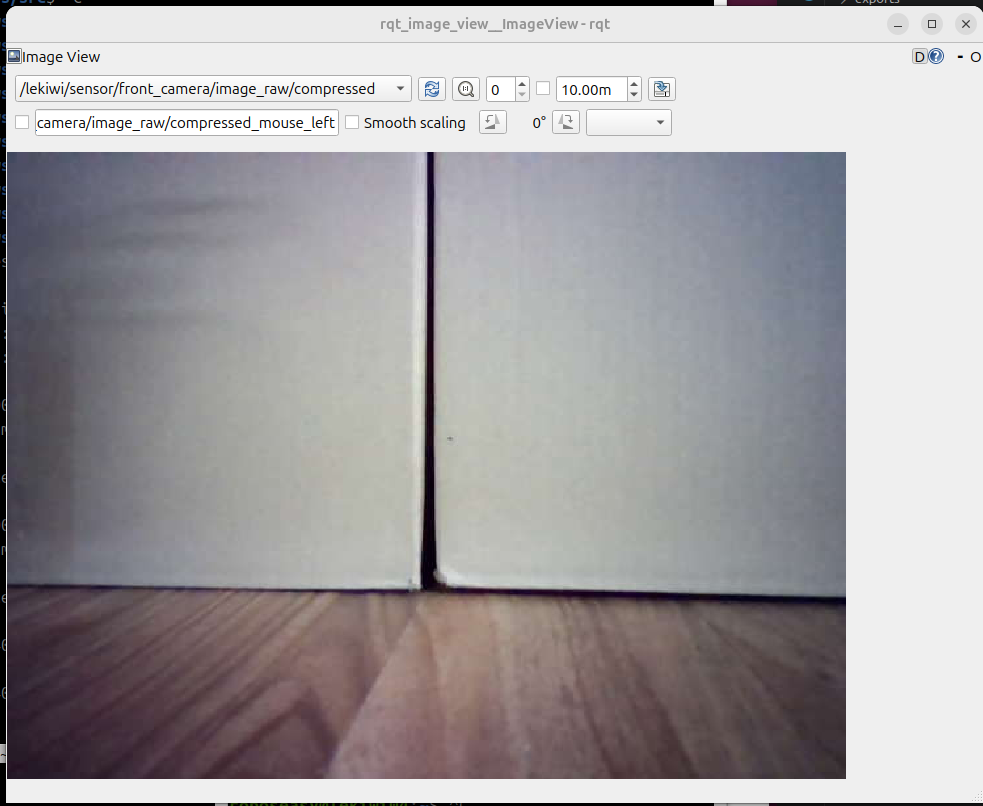
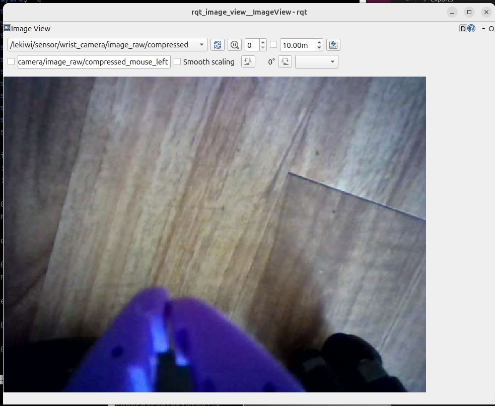

# LeKiwi 카메라 영상 보기 (rqt_image_view)

PC에서 LeKiwi의 **전방 카메라와 손목 카메라** 영상을 보는 방법.

- 카메라는 Pi의 `lekiwi_camera`가 직접 읽어 JPEG(압축 영상)로 보낸다. PC는 받아서 보여 주기만 한다.
- PC에서 빌드할 것은 없다. **압축 영상 플러그인 하나만** 설치한다.
- 대상: Ubuntu 24.04 · ROS 2 Jazzy PC, 같은 네트워크의 LeKiwi (예: `lekiwi04`)

| 전방 카메라 | 손목 카메라 |
|:-----------:|:-----------:|
|  |  |
| `/lekiwi/sensor/front_camera/image_raw/compressed` | `/lekiwi/sensor/wrist_camera/image_raw/compressed` |

*2026-10-18 lekiwi04에서 본 정상 화면: 전방 카메라는 로봇 정면의 벽과 바닥, 손목 카메라는 그리퍼(보라색)와 바닥이 보인다. 둘 다 회전 없이(`rotation: 0`) 표시했다.*

---

## 1. 처음 한 번만 준비 (PC)

### 압축 영상 플러그인 설치 (비밀번호 필요)

```bash
sudo apt install ros-jazzy-compressed-image-transport
```

카메라 영상은 JPEG로 압축해서 온다. 이 플러그인이 없으면 `rqt_image_view` 목록에 카메라 토픽이 나오지 않는다.

---

## 2. 매번 하는 순서

### ① Pi에서 카메라 켜기

PC에서 Pi로 접속한 터미널(또는 Pi 터미널)에서 실행한다.

```bash
ssh roboseasy@lekiwi04.local
ros2 launch lekiwi_camera lekiwi_camera.launch.py
```

`[front_camera_node]`, `[wrist_camera_node]` 각각에 아래 세 줄이 나오면 정상이다. 이 터미널은 켜 둔다. 끌 때는 `Ctrl+C`.

```text
camera ready on ... (/dev/video0): MJPEG 640x480 @ 30.0 fps, rotation 0 deg, frame=front_camera_optical_frame
publishing /lekiwi/sensor/front_camera/image_raw/compressed, /lekiwi/sensor/front_camera/camera_info
first frame: ... bytes from camera, ... bytes published, 640x480
```

손목 카메라는 `(/dev/video2)`, `wrist_camera`로 나온다.

> **로봇 전체(브링업)와 함께 켤 때**는 위 명령 대신 `ros2 launch lekiwi_bringup bringup.launch.py use_camera:=true`를 쓴다.
> 두 명령을 **동시에 켜지 않는다.** 같은 카메라를 두 프로그램이 열 수 없다.

### ② (선택) Pi에서 영상이 나오는지 확인

Pi 터미널을 하나 더 열어 실행한다. `average rate`가 약 30이면 된다. `Ctrl+C`로 멈춘다.

```bash
ros2 topic hz /lekiwi/sensor/front_camera/image_raw/compressed
ros2 topic hz /lekiwi/sensor/wrist_camera/image_raw/compressed
```

### ③ PC 새 터미널에서 환경 설정

**새 터미널을 열 때마다** 세 줄을 입력한다. 도메인 번호는 Pi와 같아야 한다.

```bash
source /opt/ros/jazzy/setup.bash
export ROS_DOMAIN_ID=42
export ROS_AUTOMATIC_DISCOVERY_RANGE=SUBNET
```

[저장소 README](../README.md#2-매번-하는-순서)의 2-② 설정(`$LEKIWI_WS` source)을 해 둔 터미널이면 그대로 써도 된다.

### ④ (선택) PC에 카메라 토픽이 보이는지 확인

```bash
ros2 topic list | grep camera
```

`front_camera`, `wrist_camera` 각각의 `image_raw/compressed`와 `camera_info`, 모두 4개가 보이면 된다.

### ⑤ 영상 보기

```bash
ros2 run rqt_image_view rqt_image_view
```

1. 왼쪽 위 **새로고침 버튼(파란 화살표)을 누른다.**
   창을 연 직후에는 목록이 비어 있어 회색 그라데이션만 보인다.
2. 목록에서 `/lekiwi/sensor/front_camera/image_raw/compressed`를 고른다.
3. 손목 카메라는 `/lekiwi/sensor/wrist_camera/image_raw/compressed`를 고른다.

두 카메라를 동시에 보려면 PC 터미널을 하나 더 열어 ③ 설정을 한 뒤 `rqt_image_view`를 하나 더 실행한다.

---

## 3. 확인: 카메라 대응과 방향

로봇은 움직이지 않는다. 확인한 날짜와 결과를 아래 표에 적는다.

- [ ] 두 영상이 끊기지 않고 나온다
- [ ] `front_camera` 토픽에 로봇 **정면**이, `wrist_camera` 토픽에 **그리퍼**가 보인다
  (헷갈리면 전방 카메라 렌즈를 손으로 가려 `front_camera` 영상이 어두워지는지 본다)
- [ ] 영상이 바른 방향이다 (바닥이 아래). 뒤집혀 있으면 [4장](#4-영상-방향-바꾸기-pi)

| 날짜 | 로봇 | 결과 | 확인한 사람 |
|------|------|------|-------------|
| 2026-10-18 | lekiwi04 | 전방 · 손목 영상 표시 확인. `front_camera`에 정면 벽 · 바닥, `wrist_camera`에 그리퍼 · 바닥. 회전 없이 바른 방향 | |

---

## 4. 영상 방향 바꾸기 (Pi)

영상이 뒤집혀 있거나 옆으로 누워 있으면 Pi에서 설정 파일의 `rotation`을 바꾼다.

1. Pi 카메라 터미널에서 `Ctrl+C`로 끈다.
2. 설정 파일을 연다.
   ```bash
   nano ~/lekiwi_ws/src/lekiwi_sensor/lekiwi_camera/config/lekiwi_camera.yaml
   ```
3. 해당 카메라(`front_camera_node` 또는 `wrist_camera_node`)의 `rotation: 0`을 바꾼다.
   시계 방향 각도다. 거꾸로면 `180`, 옆으로 누웠으면 `90` 또는 `270`.
4. 저장(`Ctrl+O`, `Enter`)하고 닫는다(`Ctrl+X`). 2-①을 다시 실행한다. 다시 빌드할 필요는 없다.

> `rotation`이 0이 아니면 Pi가 JPEG를 풀고 돌려 다시 압축하므로 CPU를 더 쓴다. 필요할 때만 켠다.

---

## 5. 문제 해결

| 증상 | 원인 · 조치 |
|------|------------|
| 회색 그라데이션만 보이고 목록이 비어 있음 | 새로고침 버튼을 누른다. 그래도 비어 있으면 아래 줄들을 확인 |
| 목록에 카메라 토픽이 없음 | PC에 플러그인 설치(1장), PC 환경 설정(2-③)을 안 한 터미널에서 실행했는지 확인. `ros2 daemon stop` 후 다시 실행 |
| Pi에서 `failed to open ...: No such file or directory` | 카메라 USB 연결 확인. 카메라를 다른 USB 포트에 꽂았으면 설정 파일의 `device` 경로를 고친다 (`ls -l /dev/v4l/by-path/`) |
| Pi에서 `Device or resource busy` 또는 `VIDIOC_STREAMON failed` | 다른 프로그램이 카메라를 쓰는 중. 브링업(`use_camera:=true`)이나 LeRobot 호스트를 함께 켰는지 확인 |
| Pi에서 `no frame from ... within ... ms` 반복 | USB 접촉 · 전원 부족. 노드가 3초마다 카메라를 다시 연다 |
| 영상이 끊기거나 늦게 따라옴 | Wi-Fi 대역폭 부족. 한 대만 보거나 로봇을 공유기 가까이 둔다 |
| 영상이 뒤집혀 있음 | [4장](#4-영상-방향-바꾸기-pi) |

---

## 참고

- 카메라 패키지 설명 (토픽 · 파라미터 · 처리 흐름): [lekiwi_sensor/lekiwi_camera/README.md](../lekiwi_sensor/lekiwi_camera/README.md)
- 라이다 · 로봇 모델 · 지도 · Nav2 보기: [저장소 README](../README.md#사용-설명서-pc에서-보고-조작하기)
